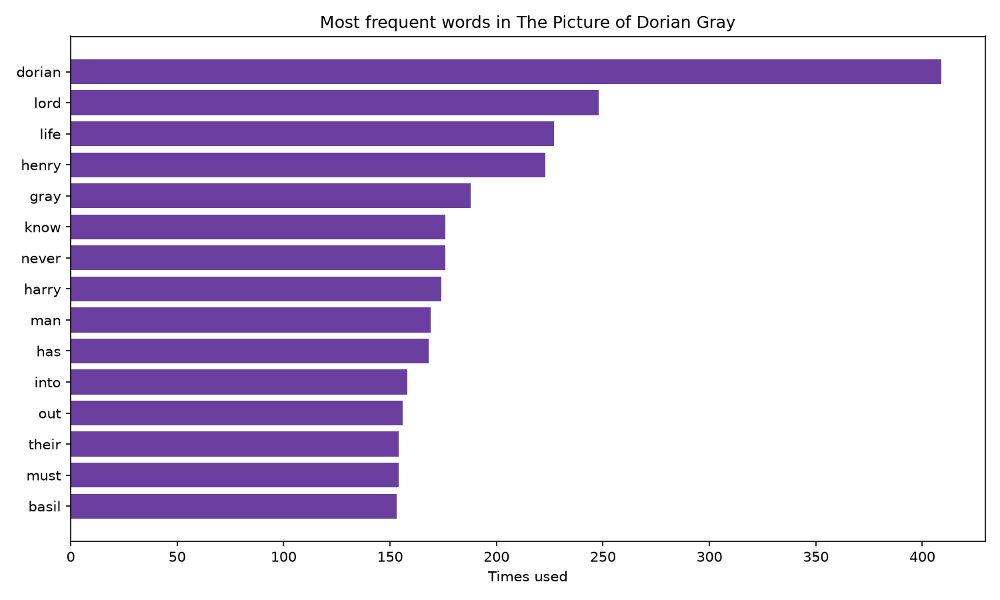

# Reading Dorian Gray with Python

*A word frequency analysis of Oscar Wilde's* The Picture of Dorian Gray

## Why this project exists

I first read *The Picture of Dorian Gray* in my Theory and Criticism of Literature class, and I loved it. Close reading gave me one way into the novel. I wanted to see what a different kind of reading would show me: if you count every word, which ideas does Wilde keep returning to?

I'm an English literature student (and an English teacher) learning to code, so this is my first Python project. It sits where I want to work: between literature, linguistics and technology.

## What it does

The script reads the full text of the novel (from [Project Gutenberg](https://www.gutenberg.org/), where it is in the public domain) and:

1. Cleans the text and splits it into individual words
2. Removes very common "stop words" such as *the*, *and* and *of*, which would otherwise dominate every result
3. Counts how often each remaining word appears
4. Prints the results and draws a bar chart of the 15 most frequent words

## What I found

- **Dorian himself dominates.** His name is one of the most frequent words in the book, which makes sense for a novel named after him.
- **One character, two names.** *Henry* and *Harry* both appear among the top words because Dorian calls Lord Henry Wotton "Harry". A computer counts them as two different words. A reader knows they are one person. This is a good reminder that counting is not the same as understanding, and that literary knowledge still matters in this kind of analysis.
- **Words like *life* appear very frequently**, which fits a novel obsessed with living fully, ageing and the cost of pleasure.

*(Replace or extend this section with your own observations from your results. The more specific and personal, the better.)*

## A bug I found along the way

My first version listed "t" and "s" among the most common words in the book. The cause: Wilde's text uses curly apostrophes (’), and my code only recognised straight ones ('). So *don’t* was split into *don* and *t*. I fixed it by converting the apostrophes before splitting the words. It was a useful lesson in how messy real text is.

## How to run it

1. Install [Python](https://www.python.org/downloads/)
2. Install the charting library: `py -m pip install matplotlib`
3. Download the text of the novel from Project Gutenberg and save it as `book.txt` in the same folder as the script
4. Run: `py analyzer.py`

## Tools used

- Python (`re`, `collections.Counter`)
- matplotlib
- Git and GitHub

## Ideas for next steps

- Plot the full frequency curve and check whether it follows Zipf's law
- Compare Wilde's vocabulary with another author, or with his own play *The Importance of Being Earnest*
- Track how key words change from chapter to chapter
- Estimate the novel's difficulty for English learners at different CEFR levels, using my experience teaching A1 to C2

## About me

English literature student and English teacher, interested in linguistics, digital media and learning to code.
